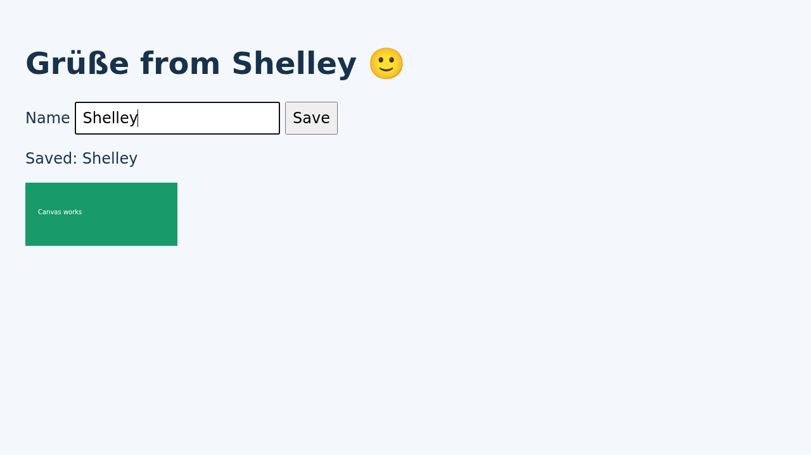

# Measurements and verification

These observations were collected on October 15, 2026, before repository cleanup.
They describe the tested runtime design, not a released image or current CI result.

## Result

The selected image uses a trimmed chromedp browser bundle, a small Git package
built from Debian sources, and a compressed browser executable unpacked into RAM.
All application/runtime tests below passed on a real AMD64 exe.dev VM.

- Fresh VM disk usage, including Shelley: **346918912 bytes (330.85 MiB)**.
- After browser/LLM tests: **348241920 bytes (332.11 MiB)**.
- After two restarts and concurrent browser tests: **360005632 bytes (343.33 MiB)**.
- Original Debian-browser VM checkpoint: **881795072 bytes (840.95 MiB)**.
- Final test-machine reduction versus that checkpoint: **59.2%**.

These are `df -B1 /` filesystem readings, not compressed registry sizes. Logs,
SQLite WAL files, screenshots, and test history explain growth during testing.
The browser executable cache is measured separately because it is a RAM tmpfs.

## Compared configurations

All live candidates used 1 CPU, 2 GiB RAM, a 10 GiB disk, Debian 13 Slim, and the
exe.dev-installed Shelley version `0.1382.946224212`. The API requires at least
10 GiB disk capacity; allocated capacity is different from space actually used.

| Configuration | Local filesystem before Shelley, KiB (`du -xsk /`) | Observed VM used bytes | VM used MiB |
| --- | ---: | ---: | ---: |
| Original Debian `chromium-headless-shell`, distro Git | 782496 | 881795072 | 840.95 |
| Full chromedp bundle, distro Git | 522436 | 607019008 | 578.90 |
| Trimmed chromedp bundle, distro Git | 499700 | 583471104 | 556.44 |
| Trimmed bundle, minimal Git | 427380 | 509435904 | 485.84 |
| Compressed bundle, minimal Git | 268672 | 346918912 | 330.85 |

VM checkpoints were taken during each experiment, not from an identical
post-boot service/history snapshot. The original VM checkpoint includes a
restart; other rows show fresh candidate observations. The local filesystem
column helps isolate image-content differences. The selected VM's final
post-test measurement is recorded separately above.

### Browser comparison

The full chromedp bundle eliminated Debian's Mesa/LLVM dependency chain. Its
pinned upstream image is:

```text
chromedp/headless-shell:stable@sha256:f70908c8020555a3bf89a070140913b443a03ead28c1a66563c3912a3b32b08d
```

It reports Chromium `156.0.8078.12`. Removing only
`libVkLayer_khronos_validation.so` and `libVkICD_mock_icd.so` saved 22736 KiB.
Software graphics libraries were retained. The tests verify actual WebGL pixel
output, not merely the presence of a shared library.

Google Chrome for Testing's Headless Shell `155.0.8059.79` was also inspected.
Its ELF dependencies include `libgbm.so.1` and the desktop graphics libraries,
which bring back the large Debian graphics chain. It was not selected for a
live comparison. The older community/serverless releases inspected did not
provide an advantage that justified selecting an older browser over the tested
chromedp build.

The chromedp command-line screenshot/DOM combination hung under AMD64 emulation.
The DevTools pipe tests passed both under emulation and on real AMD64 VMs.
The test suite therefore uses the same class of protocol as Shelley's browser
integration rather than treating command-line screenshot flags as the product.

### Git comparison

Minimal Git was built from Debian source package `1:2.47.3-0+deb13u1`, with its
Debian patches, using size optimization and disabling Perl, Tcl/Tk, Python,
and gettext. It is installed as a dpkg-managed package, with runtime dependencies
computed by `dpkg-shlibdeps`. Its installed-size metadata is 18652 KiB.

Commit, branch, merge, rebase, local clone/push, worktree, submodule, archive,
PCRE search, GC/fsck, and HTTPS `ls-remote` passed on a real VM. Replacing the
minimal package with `apt-get install git` was also checked in a disposable
container; the selected executable became Debian's `/usr/bin/git`.

This is a core Git build, not a claim that optional scripting tools or translated
messages are present. The full Debian package can replace it through apt.

### Compression and RAM

The approximately 232 MiB browser executable compresses to about 75 MiB using
Zstandard level 19. It is extracted into `/run/browser`, an executable tmpfs
limited to 320 MiB and owned by `exedev`. Resource files remain on disk and are
linked into that directory. An exclusive lock, temporary directory, checksum,
and atomic rename coordinate concurrent initial launches.

The version fast path avoids unpacking for `--version` checks. Opening Shelley's
API and querying the browser version after restart left the cache empty.
The browser cache disappears on reboot; conversations and user files persist.

Observed measurements on the selected 2 GiB VM:

| Checkpoint | MemAvailable, KiB | Shmem, KiB |
| --- | ---: | ---: |
| Fresh, before browser launch | 1925344 | 48 |
| After standalone browser test and browser exit | 1659520 | 237200 |
| After Shelley performed browser actions | 1596356 | 241776 |
| After concurrent checks following restart | 1673200 | 237204 |

The cache itself occupied 237152 KiB. This moves storage into RAM; it is not
free memory. The figures above are observed snapshots, not peak-RAM guarantees.

Browser readiness via the SSH test transport was 1203 ms cold and 298 ms warm.
Two simultaneous cold-cache launches after restart both passed, at 1316/1317 ms
readiness. These are individual observations on this VM, not benchmark promises.

## Functional verification

Passed on the selected real exe.dev VM:

- VM creation and automatic Shelley installation by exe.dev.
- `shelley_url` returned by the platform, with private HTTPS access.
- Home/config ownership and writable home directory for `exedev`.
- No failed systemd units; browser tmpfs, Shelley socket, D-Bus, journald, and
  the user service manager active.
- Shelley API returns 403 without the expected identity header and 200 with it.
- Browser JavaScript, real keyboard insertion and mouse clicks, Canvas pixels,
  WebGL pixels, PNG screenshot, umlauts/emoji rendering, and HTTPS navigation.
- Core Git workflows and public HTTPS repository access.
- Two VM restarts, persistent user files and Shelley conversation, and browser
  cache reset/recreation.
- Concurrent cold-cache browser launches with exactly one completed cache directory.

Shelley itself used its built-in browser tools to open a local fixture, type
`Shelley`, click Save, verify `Saved: Shelley`, capture a screenshot, then open
`https://example.com` and check the `Example Domain` title. The conversation
remained readable after restart. No package installation or configuration
modification was allowed in that prompt.



The dashboard button has **not** been visually checked. The label, platform
agent metadata, Shelley installation, authenticated local API, and actual agent
browser use were checked. The external HTTPS route redirects unauthenticated
requests to exe.dev login; no browser authentication was performed by the agent.

## Scope of the evidence

Local builds, ShellCheck, workflow linting, browser checks, and Git checks passed
for the original experiment. GitHub CI was not run for that uncommitted state.
After repository cleanup, a new AMD64 image built successfully on an ARM Docker
host using emulation. Smoke tests (including browser actions and rendered WebGL),
core Git tests, ShellCheck, workflow linting, and corresponding-source export
passed. The exported Dockerfile and Git script matched the working files.
Local filesystem contents remained 268672 KiB (`du -xsk /`), before Shelley.

The cleaned image has not been booted on a new exe.dev VM or in a native AMD64
systemd container. The updated GitHub workflow has not run remotely. Existing
VMs were not modified during cleanup.

Test images were temporary experiment artifacts, not durable releases. The
comparison recipes were removed from the maintained source tree; the table
above retains their observed results. Future releases must pair a tested image
digest with its corresponding Git sources, as described in
[publishing](publishing.md).
